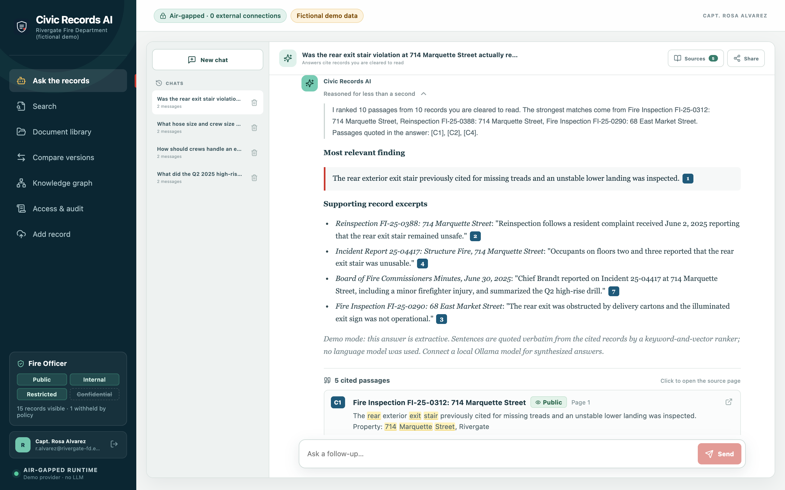
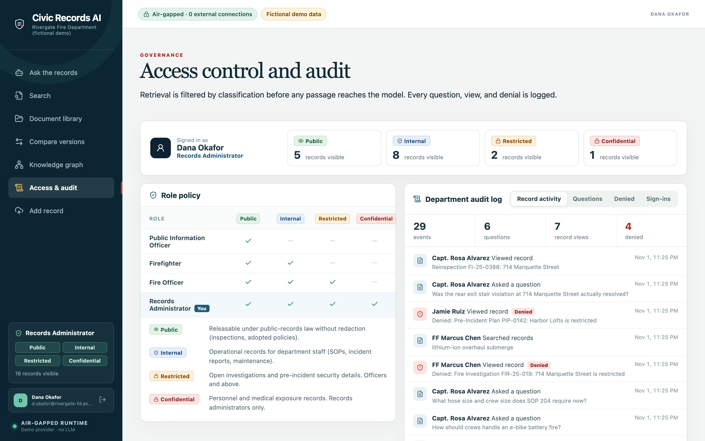
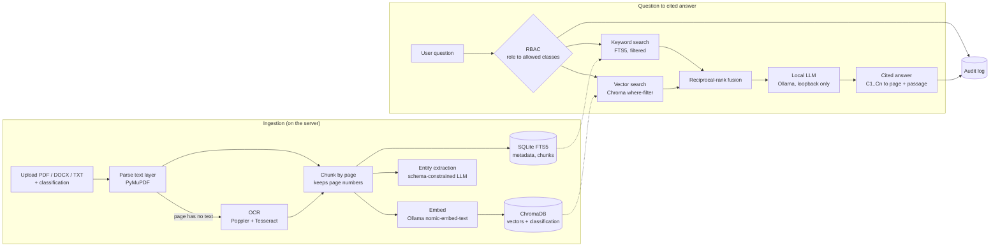

# Civic Records AI

**On-prem, air-gapped document intelligence for public safety and local government. The data never leaves the building.**

Fire departments and municipal offices keep years of incident reports, inspections, SOPs, and investigation files as PDFs and scans. Staff need answers they can trust ("Was that egress violation actually fixed?", "What does the current high-rise SOP require?"), but the records often can't go to a cloud AI service. Civic Records AI runs the whole pipeline on one server: OCR, embeddings, vector search, and a local LLM. Every answer cites the exact source page, retrieval is filtered by each user's clearance, and every question and record view goes into an audit log.

> Concept demo. It isn't affiliated with any city or department. The bundled "Rivergate Fire Department" corpus and every person, address, and case number in it are fictional.





## Features

- **Cited answers.** Ask in plain language and get an answer where each claim carries a `[C#]` citation. Citation cards show the record, its classification, the page, and the matching passage with highlighting. Clicking one opens the PDF at that page with the passage highlighted.
- **Role-based access by classification.** Records are classed Public, Internal, Restricted, or Confidential, and each role sees only the classes it's cleared for. Filtering happens *inside retrieval* (in the SQLite query and the ChromaDB `where` clause), so a withheld passage never reaches the model. Direct record views and downloads are checked again.
- **Audit log.** Questions (with the records each answer cited), searches, record views, downloads, ingests, comparisons, sign-ins, and denied attempts are all logged. Records administrators see the whole department's log; everyone else sees only their own activity.
- **Ingestion with OCR.** Handles PDF, DOCX, TXT, and MD. A PDF page with no text layer is rasterised (Poppler) and OCR'd locally (Tesseract), and the library shows which records were OCR'd. Uploads are classified at ingest, and only roles with the `ingest` permission can add records.
- **Hybrid search.** SQLite FTS5 (BM25) and ChromaDB cosine search, merged with reciprocal-rank fusion.
- **Version comparison.** Shows what changed between two revisions of a record, such as an SOP. You get an exact diff plus a summary.
- **Conversations.** Chats persist, and you can share one read-only with a colleague. When they open a cited record, it's checked against *their own* clearance.
- **Knowledge graph.** People, addresses, case numbers, and organisations extracted across records, shown in a 3D graph.
- **Demo mode.** Runs on any laptop with no GPU, no Ollama, and no network (see below).

## Architecture



The browser talks only to FastAPI. FastAPI talks only to Ollama on `127.0.0.1`: a non-loopback `OLLAMA_BASE_URL` is refused at startup. ChromaDB is embedded with telemetry disabled, and the React bundle loads no fonts, scripts, or assets from a CDN.

## Stack

| Layer | Technology |
|---|---|
| API | Python 3.11+, FastAPI, Uvicorn, Pydantic |
| Storage | SQLite (WAL, FTS5) for records, chunks, users, sessions, conversations, audit log |
| Vectors | ChromaDB (embedded, persistent, cosine) |
| Parsing / OCR | PyMuPDF, python-docx, pdf2image + Poppler, pytesseract + Tesseract |
| Models | Ollama: `qwen3:14b` for chat and extraction, `nomic-embed-text` for embeddings (both configurable) |
| Frontend | React 18, Vite, pdf.js (in-browser PDF rendering and highlighting), react-markdown, 3d-force-graph |
| Tests / CI | pytest, ruff, GitHub Actions (backend lint and tests, frontend build) |

## Security model

| Control | Status |
|---|---|
| All inference, embedding, OCR, and storage on the local host. No cloud AI fallback | Implemented |
| Ollama URL restricted to loopback, Chroma telemetry off, no CDN assets | Implemented |
| Classification-based RBAC enforced in retrieval (SQL and vector filter) and on record view/download | Implemented |
| Ingest permission and "can't file above your own clearance" check | Implemented |
| Audit log of questions, cited records, views, downloads, ingests, denials, sign-ins | Implemented (append-only by convention, not tamper-evident) |
| Passwords stored as salted scrypt hashes. Sessions are opaque tokens, stored hashed, sent as HttpOnly SameSite=Strict cookies with a 12-hour expiry | Implemented |
| Shared conversations are read-only, and cited records are re-checked against the viewer's role | Implemented |
| SSO (SAML/OIDC, Active Directory), MFA, role-management UI | Planned. Roles are currently set in the database or the seed |
| Tamper-evident audit log (hash chain), log export to SIEM | Planned |
| Encryption at rest, per-record ACLs beyond classification, automated redaction | Planned |
| Knowledge-graph observations filtered per source record | Planned. Entities and relations are filtered by classification, but an entity's merged observation text can mention a record the viewer isn't cleared for |

For production, put the app behind HTTPS on the internal network, leave `CIVIC_RECORDS_DEMO` off, and connect the department's identity provider.

## Quick start: demo mode (no GPU, no Ollama)

You need Python 3.11+ and Node 20+. Tesseract and Poppler are optional; they're needed only for the scanned sample record.

```bash
git clone https://github.com/pixelate-solutions/civic-records-ai.git
cd civic-records-ai
./scripts/demo.sh --reset        # venv, deps, frontend build, seed, serve
# open http://127.0.0.1:4106 and pick a demo account
```

The seed creates 16 fictional records (SOPs, inspections, incident reports, a restricted fire investigation, a restricted pre-incident plan, a confidential exposure record, board minutes, and one scanned hydrant log that is OCR'd at ingest). It also creates four accounts with different clearances and a short backfilled audit trail.

| Demo account | Role | Can see |
|---|---|---|
| Jamie Ruiz | Public Information Officer | Public |
| FF Marcus Chen | Firefighter | Public, Internal |
| Capt. Rosa Alvarez | Fire Officer | + Restricted; can add records |
| Dana Okafor | Records Administrator | Everything; full audit log |

Try asking *"Was the rear exit stair violation at 714 Marquette Street actually resolved?"* as Capt. Alvarez, then search "714 Marquette fire cause" as Jamie Ruiz. The restricted investigation never appears.

**What demo mode is, honestly.** With no Ollama, the app uses a built-in CPU-only provider instead:

- **Embeddings** are a deterministic feature-hashed bag of words (384 dimensions). Real vectors in ChromaDB, but not a neural model.
- **Answers** are *extractive*. The highest-ranked sentences from retrieved passages are quoted verbatim with citations, and no text is generated. Each answer says this in its footer.
- **Comparisons** are a sentence-level diff, and **graph extraction** uses regular expressions (noticeably noisier than the LLM extraction).

Retrieval, RBAC, audit, OCR, citations, and the UI are the same code paths in both modes.

## Running with a local model (Ollama)

```bash
brew install tesseract poppler            # or: apt-get install tesseract-ocr poppler-utils
ollama pull qwen3:14b && ollama pull nomic-embed-text   # do this before disconnecting from the network
CIVIC_RECORDS_AI=ollama ./scripts/demo.sh --reset
```

With the default `CIVIC_RECORDS_AI=auto`, the app uses Ollama when it's reachable and both models are pulled; otherwise it falls back to demo mode. The two providers write to separate Chroma collections, so reseed with `--reset` when you switch. `qwen3:14b` fits comfortably on a 24 GB Apple Silicon Mac; use `qwen3:8b` on smaller machines. The streamed answer path shows a short evidence analysis, then the cited answer.

> The Ollama path is carried over from the original build and was not exercised in the latest pass, which ran on a machine without Ollama. Demo mode and the test suite cover everything else.

### Configuration

| Variable | Default | Purpose |
|---|---|---|
| `CIVIC_RECORDS_AI` | `auto` | `auto`, `ollama`, or `demo` |
| `CIVIC_RECORDS_DEMO` | off | Enables one-click demo sign-in. Never enable in production |
| `CIVIC_RECORDS_DATA_DIR` | `backend/data` | SQLite, Chroma, and uploaded files |
| `CIVIC_RECORDS_DEPLOYMENT` | Rivergate Fire Department (fictional demo) | Name shown in the sidebar |
| `OLLAMA_BASE_URL` | `http://127.0.0.1:11434` | Must be loopback |
| `OLLAMA_LLM_MODEL` / `OLLAMA_EMBED_MODEL` | `qwen3:14b` / `nomic-embed-text` | Model names are configuration, not code |

### Frontend development

```bash
uvicorn app.main:app --app-dir backend --port 4106   # API
cd frontend && npm run dev                            # http://127.0.0.1:5173, proxies /api to :4106
```

### Verifying the air gap

Build and seed while online, then disconnect the network and run the walkthrough. In the browser's Network tab, every request should go to `127.0.0.1`. On the server, `lsof -i -n -P | grep -E 'uvicorn|ollama'` should show only loopback connections.

## API overview

| Method | Path | Notes |
|---|---|---|
| `POST` | `/api/ask/stream` | NDJSON stream: retrieval trace, evidence analysis, answer tokens, citations |
| `POST` | `/api/ask` | Non-streaming cited answer |
| `POST` | `/api/search` | Hybrid search, filtered by role |
| `GET` | `/api/documents`, `/api/documents/{id}`, `/api/documents/{id}/file` | Role-checked and audited |
| `POST` | `/api/documents/upload` | Multipart `file` + `classification`; needs the `ingest` permission |
| `POST` | `/api/compare` | Diff and change summary for two records |
| `GET` | `/api/access-policy` | Roles, classifications, visible counts for the current user |
| `GET` | `/api/audit` | Full log for records administrators, own activity for everyone else |
| `GET` | `/api/graph` | Entities and relations from records the user can see |
| `GET` | `/api/health` | Provider, models, document count |

Interactive docs are at `http://127.0.0.1:4106/docs`.

## Tests

```bash
.venv/bin/pip install -r backend/requirements-dev.txt
.venv/bin/ruff check backend
cd backend && ../.venv/bin/python -m pytest
```

The 16 tests cover: retrieval fusion, page-preserving chunking, demo embeddings, extractive citation behaviour, sentence-level comparison, session enforcement, the per-role visibility matrix for listing and search, answers never citing records above the user's clearance, audited denials on view and download, audit-log scope, ingest permissions, and the loopback-only model guard. CI runs lint, tests, and the frontend build on every push.

Not yet covered: frontend unit tests, an answer-quality evaluation set, and the Ollama provider (it needs a model in CI).

## Project layout

```
backend/app/
  main.py         API routes, streaming ask, RBAC checks, audit hooks
  ai.py           provider facade: Ollama or CPU-only demo
  demo_ai.py      hashing embeddings, extractive answers, regex graph, sentence diff
  ollama.py       loopback-only Ollama client (chat, stream, embed, schema-constrained extraction)
  rbac.py         roles, classifications, permissions
  audit.py        audit log
  search.py       FTS5 + Chroma hybrid retrieval with classification filters
  ingestion.py    parse, OCR, chunk, embed, extract, persist
  seed_demo.py    fictional corpus, demo accounts, sample audit trail
frontend/src/     React app (ask, search, library, compare, graph, access & audit, upload)
```

## Attribution

The knowledge-graph screen adapts rendering patterns from Seth Rose's MIT-licensed Memory Knowledge Graph 3D. See [THIRD_PARTY_LICENSES.md](THIRD_PARTY_LICENSES.md).
